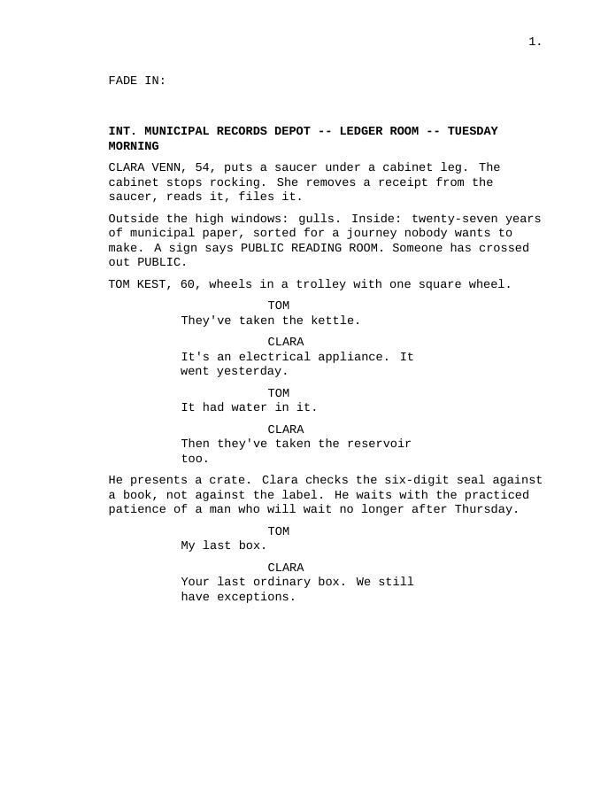
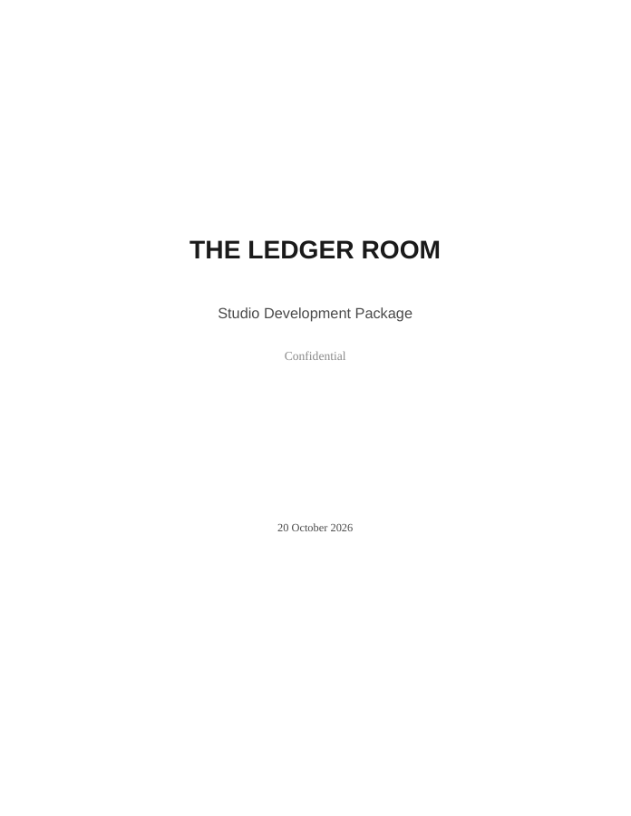

# Story Factory

**Your idea. Your voice. A writing room that carries the work forward.**

Story Factory helps you and your AI assistant discover the movie inside an idea, write a complete screenplay, challenge what is weak, and prepare the materials you choose to share. Start with a sentence, a draft, or a book you want to adapt. You stay the author: the assistant does the work, explains its recommendations, and preserves your creative decisions.

**[Visit the step-by-step website](https://jayzalowitz.github.io/story-factory/)** · **[Explore the full writing guide](https://jayzalowitz.github.io/story-factory/guide.html)** · **[Download Story Factory](https://github.com/jayzalowitz/story-factory/releases/download/v0.2.0-preview.4/story-factory-0.2.0-preview.4.zip)** · **[Read a finished screenplay](https://jayzalowitz.github.io/story-factory/examples/the-letter-to-the-father/screenplay.pdf)** · [View on GitHub](https://github.com/jayzalowitz/story-factory)

No coding experience required. You need one assistant that can read and save project files: **Claude Code or Codex**. Story Factory is free; your chosen AI service has its own plans, usage limits and possible charges. The [beginner guide](docs/START_HERE.md) explains accounts, apps, opening a folder and missing tools in plain language.

## One command, the whole process

**Claude Code: `/story-run` · Codex: `$story-run`**

For the full kind of project shown by *The Letter to the Father*, paste this into Claude Code. In Codex, replace the opening `/story-run` with `$story-run`:

> /story-run My idea is: [your idea]. Create a separate feature-film project and carry it from discovery and research where needed through characters, outline, complete screenplay, full-draft review, meaningful revisions, continuity and Bechdel checks, all 15 studio-package sections, all 16 pitches, and built, visually inspected PDFs with editable sources. Ask me one useful question at a time for important creative choices; handle the routine steps and save progress between sessions. Do not send or publish my work.

**Explore → shape the story → write → challenge and revise → make your selected materials → inspect and hand over.** Research and adaptation join the process when your material calls for them. You do not need to invoke each stage yourself or know the vocabulary of screenplay development.

You can choose a smaller destination in the same request: “Only a screenplay, synopsis, character descriptions and an actor pitch.” The complete selection produces **18 PDFs**: one screenplay, one assembled development package containing 15 sections, and sixteen separate one-page pitches. Those are choices, not a quota. [See every option](docs/PACKAGE.md).

One command coordinates sustained work; a feature can span several sessions or usage resets. Reopen **your story's folder**, then send:

| Claude Code | Codex |
|---|---|
| `/story-resume Tell me where we stopped and continue the next agreed step.` | `$story-resume Tell me where we stopped and continue the next agreed step.` |

The project files hold the screenplay, decisions and next action. Keep a backup of the folder. Missing tools, unresolved research and unfinished checks stay visible. Ask for dry wit and restraint if you want those qualities from the original example; another story can have a completely different voice.

## Your first session

1. [Download](https://github.com/jayzalowitz/story-factory/releases/download/v0.2.0-preview.4/story-factory-0.2.0-preview.4.zip) and unzip Story Factory. Open that folder in Claude Code or Codex. Downloading this public toolkit does not publish your private story.
2. Paste the setup message below. The assistant checks what is available and helps create a **separate story folder**, preserving the toolkit and existing work.
3. Start the writing with `story-run`. Answer meaningful creative questions; let the assistant handle the routine steps.

> Set up Story Factory for my current assistant in this folder using its install.py. I am new to this: explain anything I must do in plain language. Check Python is available first. Install the project skills for my current assistant, then tell me exactly which folder to reopen if needed. Help me create a separate story project without overwriting anything. My starting idea is: [your idea]. Ask one useful question at a time. I will choose which final files I want. Do not send or publish my work.

These are instructions to your assistant. You do not need to learn terminal commands to begin. If the writing commands do not appear, reopen the folder as instructed and ask for `story-setup`; Codex also has a skill picker (`/skills`).

## Start from what you already have

| Your starting point | What to ask for | What happens first |
|---|---|---|
| An image, question or loose premise | `story-run`, or `story-office-hours` to explore first | Find a specific person, pursuit and difficult choice before committing to an outline. |
| An existing screenplay | `story-studio` | Read the draft, identify what to protect, explain the strongest repairs, and let you choose. Your original is preserved. |
| A novel, memoir, article, play or other source | `story-adapt` | Preserve and read the agreed source, establish what must survive, then translate it into cinematic scenes. |
| A real event or person's life | `story-run` with “based on” or “inspired by” | Establish the truth promise, research material claims, and distinguish documented events from invention. |
| An outline or partially finished project | `story-resume` for a saved project, or describe what you have | Inspect the existing work and continue from the actual unfinished step. |
| Just one task | Name it: `story-review`, `story-package`, `story-check`… | Work within that scope; do not manufacture a completed feature around a smaller request. |

Prefix command names with **`/` in Claude Code** or **`$` in Codex**. For example: `/story-studio Read my draft. Protect the unresolved ending and two-location plan. Ask before rewriting.` You can also use `story` when you want help choosing the next step. [All 21 commands with examples](docs/COMMANDS.md).

## See the writing, then see the work behind it

<a href="https://jayzalowitz.github.io/story-factory/examples/the-ledger-room/screenplay.pdf"></a> <a href="https://jayzalowitz.github.io/story-factory/examples/the-ledger-room/studio-package.pdf"></a>

*Actual pages from The Ledger Room. Select either page to open its PDF.*

- **[The Letter to the Father](examples/the-letter-to-the-father/README.md):** the project from which the process was extracted. Read its measured [106-page screenplay](site/examples/the-letter-to-the-father/screenplay.pdf), [45-page package](site/examples/the-letter-to-the-father/studio-package.pdf) and sixteen pitches. It predates these commands; it does not prove a command recreates its writing or page count.
- **[The Ledger Room](examples/the-ledger-room/README.md):** a new original feature demonstration with 90 dramatic pages plus its title page, all 15 package sections and sixteen pitches. The saved [review](examples/the-ledger-room/development/review.md), [revision log](examples/the-ledger-room/development/revision_log.md) and [current quality report](examples/the-ledger-room/development/quality_report.md) expose the diagnosis, focused repairs and remaining limits. The separate AI reader's coverage was bounded; it was not professional certification.
- **[The Night Window](examples/the-night-window/README.md):** a new short demonstration with a 10-page screenplay, 17-page package and sixteen one-page pitches, produced and checked on this agent host.
- **[Twelve Seconds](examples/adaptation/README.md)** and **[The Pool](examples/true-story/inspired-by/README.md):** compact demonstrations of source adaptation and different truth promises. Their research and review limits are explicit.

[Browse the public PDF gallery](https://jayzalowitz.github.io/story-factory/#examples). Proposed casting, budgets, financing and awards language in these development examples are illustrative; they are not confirmed attachments, sales or clearance claims.

## Go deeper when you want to

The first-session route above is enough to start. Open a topic below when you want to understand a decision, choose a deliverable, or take more control. The assistant still carries the process. Prefer a dedicated reading page? The **[full writing guide](https://jayzalowitz.github.io/story-factory/guide.html)** connects the craft, worked revisions, every package choice and the next development steps; its [Markdown edition](docs/DEEP_DIVE.md) stays with the project.

| If you want to understand… | Read next |
|---|---|
| How an idea becomes scenes that change a story | [The craft path](#the-craft-path) · [full craft guide](https://jayzalowitz.github.io/story-factory/guide.html#craft) |
| How a studio review protects your authorship | [Choosing revisions](#choosing-revisions) · [studio guide](https://jayzalowitz.github.io/story-factory/guide.html#studio) |
| Which documents are useful to which readers | [Choosing your materials](#choosing-your-materials) · [all materials explained](https://jayzalowitz.github.io/story-factory/guide.html#package) |
| What adaptation and truth labels actually require | [Sources and truth](#sources-and-truth) · [source guide](https://jayzalowitz.github.io/story-factory/guide.html#sources) |
| Why a complete draft still needs review | [Quality and evidence](#quality-and-evidence) · [revision](https://jayzalowitz.github.io/story-factory/guide.html#revision) and [quality guide](https://jayzalowitz.github.io/story-factory/guide.html#quality) |
| How work survives a long conversation or a new session | [Saved project state](#saved-project-state) · [context guide](https://jayzalowitz.github.io/story-factory/guide.html#context) |
| Exact installation commands, builds and optional helpers | [Advanced controls](#advanced-controls) · [advanced guide](https://jayzalowitz.github.io/story-factory/guide.html#advanced) |

<a id="the-craft-path"></a>
<details>
<summary><strong>The craft path: from a promising image to a movie with consequences</strong></summary>

An image can suggest a film without yet sustaining one. “A lighthouse keeper receives letters from lost ships” gives us atmosphere and a mystery. It does not tell us why this person acts today, what another person wants, or why the ending matters. Discovery turns that image into a conflict you can write.

A useful question is: **“What does the first letter let her avoid doing today?”** Suppose your answer is that Mara is postponing the sale of the lighthouse and her daughter Nina's departure. Now there are competing pursuits: Mara wants to keep a shared life intact; Nina wants a survey job elsewhere. Whether the letters are supernatural remains your choice. A literal ghost story, grounded mystery and ambiguous family drama would make different promises to the audience.

The stages develop that promise rather than simply add pages:

| Stage | The decision it resolves | The useful result |
|---|---|---|
| Discovery and premise | What is the particular movie, for whom, and why now? | A brief and story bible: the central pursuit, opposing wants, tone, constraints and ending hypothesis. |
| Character and structure | What does each person do, and what changes because of it? | An outline and scene map linking choices, costs, chronology and later consequences. |
| Draft | What can an audience actually see and hear? | Complete action and dialogue, including the difficult middle and actual ending. |
| Review and revision | Which scenes fail the movie's own promise? | Prioritized problems, substantive repairs, protected strengths and evidence that the repairs work. |
| Package and delivery | How can another reader understand this exact revised film? | Selected documents aligned to the script, real PDFs, editable sources and an honest handoff. |

**A worked scene choice.** A weak kitchen scene has Nina relay an absent man's explanation while Mara asks why he left. It supplies backstory but leaves Nina serving somebody else's story. Repeating it with more elegant dialogue would not give the middle forward motion.

A different scene gives Nina a coastal survey leaving at six and a last ferry at five. She chooses an overnight stay. Mara writes a payment on an electricity bill to extend their living arrangement; Nina crosses it out and pays only through tonight. The practical conflict carries the emotional one. Nina's departure changes what Mara can do next, so the writer must make that absence matter later.

That is the distinction between **information** and **drama**: not every scene needs an argument, but something should change that the rest of the film needs. The [full teaching example](examples/quality/README.md) shows the dialogue and its limits. It is invented instructional material, not a record of a completed project.

The same principle guides other craft choices. A quiet protagonist can act by withholding or refusing. An antagonist needs the power to pursue a comprehensible goal. Supporting people need choices that inconvenience the lead. Nonlinear structure needs both screen order and a clear underlying chronology. Humor, warmth and competence can create contrast; depth does not require unbroken solemnity. An ending earns its force when it spends something the audience has learned to value.

Use the [worked command journey](examples/WALKTHROUGH.md) for the sequence, the [deeper guide](docs/DEEP_DIVE.md) for more explanation, and [MASTER_PROMPT.md](MASTER_PROMPT.md) for the complete craft requirements. The original feature's tone and structure are examples, not a template every film must imitate.

</details>

<a id="choosing-revisions"></a>
<details>
<summary><strong>Choosing revisions: a studio meeting with you in charge</strong></summary>

`story-studio` begins with reading your existing screenplay and boundaries. It should not restart discovery or replace your voice before it understands the work. A useful review identifies what already works, then proposes consequential changes with scene evidence and tradeoffs. “The middle needs more tension” is too vague to approve.

For example, in the [illustrative studio session](examples/STUDIO_SESSION.md), a caller supplies a radio operator's solution. The proposed repair makes the operator choose to broadcast an uncertain warning. **Gain:** the climax follows her action. **Cost:** she becomes partly responsible if the warning is wrong. That is a meaningful choice for the writer, not an automatic improvement in every story.

You can **accept and apply**, **explore an alternative**, **defer**, or **keep the original**. “Accept, but she must explicitly say the report is unconfirmed” narrows the revision. “Explore another option” permits discussion, not implementation. “Keep my unresolved ending” remains binding even if a review favors a neat resolution. If you ask the assistant to make routine decisions, it records those assumptions; it still respects your stated limits.

After an accepted change, the assistant updates the actual scenes and their records, rereads the lead-in and aftermath, and checks affected setups, payoffs and continuity. A decision is not “applied” merely because a plan describes it. A deferred operational question remains unresolved until the relevant research and choice occur.

You need not approve every sentence. Set the boundary in ordinary language: “Repair the repeated arguments, but ask before changing the ending, merging characters or adding locations.” The goal is a small number of well-explained choices, one useful question at a time, rather than a questionnaire or a silent rewrite.

</details>

<a id="choosing-your-materials"></a>
<details>
<summary><strong>Choosing your materials: what each document does and when it helps</strong></summary>

A screenplay is the movie in scenes. A development package explains the movie, its creative approach and its practical questions. A pitch gives a particular reader a reason to consider it. These documents serve different purposes; sixteen interchangeable sales pages do not become useful merely by having different headings.

| Material | What it gives the reader | Choose it when… |
|---|---|---|
| Screenplay | Complete action and dialogue, not a summary of missing scenes. | You want someone to read the actual film, or you are ready for a table read and development notes. |
| Logline and synopsis | A quick premise, then a compact account of the plot and actual ending. | Someone needs to understand the story before committing to a full read. A synopsis can disclose the ending even when publicity would not. |
| Treatment | A longer prose telling of the whole film's causal and emotional movement. | You want to discuss structure and experience without asking a collaborator to read script format. |
| Character breakdowns, tone and visual world | Conflicts, arcs, performance opportunities and cinematic approach. | You need a shared creative understanding with a potential collaborator. |
| Comparables and positioning | Specific similarities and differences in audience, form or production ambition. | You need to explain where the film fits. Artistic resemblance alone is not evidence of likely revenue. |
| Casting/director/producer proposals | Reasons a kind of collaborator could fit. | You are exploring a package. Proposed people remain uncontacted and unattached unless real evidence establishes otherwise. |
| Budget, festival, awards and risk sections | Preliminary assumptions, dependencies and questions to resolve. | These questions are useful at your development stage. Selecting a page does not make a budget validated or a campaign viable. |
| Reader-specific one-page pitch | The most relevant case for one kind of reader. | You know the audience for the document and want a focused invitation to consider the work. |

**Worked selection:** you have a first short film and want feedback from an actor friend. A screenplay, synopsis, character breakdowns and actor pitch may be useful. The actor pitch should explain the role's contradictions, choices and playable scenes. A financier pitch would instead explain scope, assumptions and unresolved financing needs; an awards strategy might add nothing to this conversation. Requesting fewer materials keeps attention on the current decision.

> Make only the screenplay, synopsis, character breakdowns and actor pitch. Label casting as hypothetical. Do not create financing or awards pages. Build and inspect those selected PDFs, and keep the editable source.

The chosen development sections are assembled into one package PDF; each selected pitch gets its own one-page PDF. The full selection contains 15 sections and 16 pitches, for 18 PDFs including the screenplay. Working research and review records support the writing; they are not extra mandatory sales documents. The assistant saves your choices in `development/package_options.json` and builds that selection. [Complete menu and precise selection behavior](docs/PACKAGE.md).

Package the revised film, not a better imaginary one. If the ending changes, the synopsis, treatment, character arcs and relevant pitches need checking again. A claim about a scene must point to a scene that actually exists. Keep private criticism and research originals separate from materials intended for readers.

</details>

<a id="sources-and-truth"></a>
<details>
<summary><strong>Sources and truth: adaptation and factual promises are separate decisions</strong></summary>

**Adaptation asks what you are transforming. Truth mode asks what you are claiming really happened.** A fictional novel can be adapted without a true-story promise. A memoir may need both adaptation choices and factual research. An original fictional plot can still need research into a profession or setting.

For adaptation, the assistant preserves the supplied original and reads the agreed scope. You establish a fidelity agreement: what must remain, what may change, and which departures need your approval. A novel's interior thought may become visible behavior; characters may be combined; chronology may be compressed. Those are creative choices with costs, not automatic conversions. Source locations are mapped to the resulting scenes so omissions and inventions remain inspectable. Missing pages or unread sections cannot silently become a claim of full-source coverage.

| Truth mode | The creative promise | What needs tracking |
|---|---|---|
| Original fiction | The people and events are invented. | Any real-world claims you make, plus source use where relevant. Fiction is not a reason to invent factual support for marketing copy. |
| Based on a true story | Central documented events meaningfully support the story. | Credible sources, contradictions, material inventions, composites, dialogue and chronology changes. |
| Inspired by true events | A real starting point permits a looser fictional transformation. | What the real starting point supports and where invented people and events depart from it. The label is not permission to present invention as fact. |

**Example:** adapting a memoir's private recollection into a two-person confrontation requires more than preserving the emotional tone. Was the encounter documented, remembered by one person, disputed, or invented for the film? The source record should say which. If a pitch then calls the confrontation a documented event, the script's creative label and the pitch's factual claim no longer agree.

The assistant researches the chronology, relationships and context that matter, reconciles competing accounts, and maintains a claim/source ledger. Before handoff it audits the *current screenplay and package*, because research approved before drafting may not support a later scene. If sources or tools are unavailable, the uncertainty stays visible. The fictional fixtures in the [research examples](examples/research/README.md) teach the record format; they are not real evidence.

Tell the assistant whether you wrote the source, have permission, believe it is public domain, or are unsure. A public webpage, a private working folder or an AI research ledger does not establish adaptation rights. Neither “based on” nor “inspired by” provides legal clearance. Read the [adaptation guide](docs/ADAPTATION.md), [worked historical short](examples/adaptation/README.md) and [comparison of truth promises](examples/true-story/README.md).

</details>

<a id="quality-and-evidence"></a>
<details>
<summary><strong>Quality and evidence: what gets challenged, repaired and rechecked</strong></summary>

**Write → read the whole draft → diagnose consequential weaknesses → repair → recheck → package and inspect.** A complete first draft is an achievement; it is not the final quality verdict. The assistant must be able to criticize its own writing with scenes and audience consequences, rather than praise the premise or count pages.

A useful finding says: “In S03 Nina supplies information but makes no decision; S09 repeats the same hurt; the middle stops changing. Give her an independent departure choice, then test its effect on the later ferry scene.” A repair log records the problem, the intervention and what the reread found. It also records what should be protected. An elegant line is expendable if it protects a broken sequence; a deliberate ambiguity is not a defect simply because it can be explained away.

The review checks the dramatic pursuit, agency, causality, escalation, distinct relationships and voices, supporting-character independence, playable action, emotional range, chronology, ending/title payoff and production scope. Full-draft means every scene of the same current draft, even when it must be read in tracked sections. An excerpt review is labeled as an excerpt.

The **Bechdel assessment** separately asks whether two named women converse about something other than a man. Identity must be supported by the work or roster, not guessed from names. The result is PASS, FAIL or UNCLEAR with scene evidence. Passing is required only if you choose that goal. Nina's independent work conversation could qualify; it still needs dramatic purpose and consequences. A token exchange can pass the narrow test while the rest of the film leaves her powerless. [See the worked contrast](examples/quality/README.md).

Reviews apply to versions. A saved **fingerprint** identifies the manuscript's actual contents; changing the screenplay makes earlier quality and Bechdel reports stale. Source-based and adapted projects also need current source/truth/fidelity checks. The workflow checks missing records, placeholder content and stale approvals; it cannot establish that a declared read was competent or that a judgment is true.

Revision is bounded: start with a full diagnosis, make focused consequential repairs, and reread the affected sequences and their connections. A structural change can require another complete read. After two repair rounds, surface a remaining consequential issue and save a precise continuation point rather than spend indefinitely to manufacture a READY label. More edits or more model opinions do not automatically mean a better film.

**What “finished” should mean for your requested handoff:** the selected writing exists; applicable reviews describe the current version; consequential unresolved problems are stated; package claims match the script; selected PDFs were actually built and every delivered page inspected; page counts and editable sources are included. Each pitch fits one readable page. A broken tool or unfinished required check leaves that part incomplete. If you asked only for an outline, it can be a completed outline request while the full-film stages remain unfinished.

That is a usable creative-development handoff, not professional certification. It does not establish historical or legal clearance, a production-ready budget, guaranteed runtime, market demand, an attachment, festival selection or an audience's artistic judgment. A human read, table test or specialist review may be the most useful next step. The [Ledger Room report](examples/the-ledger-room/development/quality_report.md) makes those limits concrete; the guide follows its [worked repairs](https://jayzalowitz.github.io/story-factory/guide.html#case-study) and explains [what to do after a draft](https://jayzalowitz.github.io/story-factory/guide.html#after-draft). [Context and quality](docs/CONTEXT_AND_QUALITY.md) explains the gates.

</details>

<a id="saved-project-state"></a>
<details>
<summary><strong>Saved project state: how a long project survives a new session</strong></summary>

An AI assistant can consider only a limited amount of material at once. Its answer also has a length limit. The screenplay, research, old drafts and conversation can exceed that space while the earlier messages are still visible on your screen. A more capable model still has a finite context window; “it is in the chat” does not mean it is being considered in full.

Story Factory keeps authoritative work in your story folder:

| Record | Why it matters on return |
|---|---|
| Brief, story bible and approved decisions | Recover the film's promise and your boundaries instead of inventing them again. |
| Screenplay, outline, scene map and continuity | Recover the actual writing, causal connections, chronology and character knowledge. |
| Source/claim and adaptation records, when relevant | Recover evidence, departures and unresolved questions. |
| Reviews, revision log and current-version checks | Distinguish completed repairs from suggestions and identify checks invalidated by later edits. |
| Status and checkpoint | Recover completed and unread scopes, open findings and the exact next action. |

The assistant loads what the next task needs, checks current files, and saves progress before interruption. For a full read that cannot fit at once, it records contiguous scene coverage, then reconciles the whole film's arcs and setups/payoffs. Summaries help navigation; they do not replace unread scenes.

Before stopping, say: **“Save our decisions, completed work, unread scenes, open problems and exact next action.”** Later reopen the story folder and use `/story-resume` in Claude Code or `$story-resume` in Codex. It should explain where you are, detect stale checks, and continue the next agreed step. Keep the folder backed up; a transcript alone is not the complete project.

This is recoverable project state, not unlimited AI memory. The assistant has to consult it. Optional memory services are unnecessary for the normal path and are not automatically connected. [More on context and checkpoints](docs/CONTEXT_AND_QUALITY.md).

</details>

<a id="advanced-controls"></a>
<details>
<summary><strong>Advanced controls: exact setup, smaller scopes, usage and optional helpers</strong></summary>

Experienced users can work stage by stage while beginners keep using `story-run`. Both routes use the same craft and delivery standard. To take control, use `story-office-hours`, `story-premise`, `story-outline`, `story-draft`, `story-review` and `story-revise`; request `story-package`, `story-check` or `story-handoff` when useful. Prefix each with `/` for Claude Code or `$` for Codex. [Command catalog](docs/COMMANDS.md).

**Terminal setup for a helper.** Python 3.9+ is required. From the downloaded or cloned toolkit folder, choose one host:

```sh
python3 install.py --project . --host claude
```

Or, for Codex:

```sh
python3 install.py --project . --host codex
```

Use `--host both` only if you want both sets of skills. Project-local installation is the default; `--user` is a separate explicit choice. The installer preserves unowned or modified skills and stops on conflicts. Reopen the assistant session if command discovery needs it. Installation checks are not proof of native model execution.

To create an independent story project instead of writing into the toolkit:

```sh
python3 story_factory/new_story.py ../my-film --title "My Film"
cd ../my-film
python3 scripts/workflow.py status
```

The destination must not exist. The new folder contains a blank writing project, publishing infrastructure and both hosts' skills, not a copy of an example film. Open **that new folder** in your assistant. On return, use the host-specific `story-resume` message shown above; `workflow.py status` is a terminal status check, not an AI writer.

PDFs need Tectonic or latexmk with XeLaTeX, plus `pdfinfo` from Poppler. On macOS with Homebrew, a helper can install `tectonic` and `poppler` after explaining that system-tool action. Writing can proceed before these are ready. Run from the story folder:

```sh
python3 scripts/setup_check.py --project .
python3 scripts/package_options.py show
python3 scripts/story_check.py build
python3 scripts/workflow.py status
```

The checked build honors `development/package_options.json`; `make all` builds every template. A successful blank-template build does not finish a story. Read [setup and build details](docs/SETUP.md) and [selection flags](docs/PACKAGE.md) before customizing the terminal route.

**Usage and helpers.** Most projects can stay with one assistant. Helper teams are off by default. They can be useful for separate research topics or a fresh continuity/quality pass; they are rarely useful for a small edit. One lead author owns the script, and helpers return findings in separate notes instead of editing the screenplay simultaneously.

> Ask before using helpers. If this session actually supports them, propose up to two for continuity and quality review, one round. Do not add a paid service, nest teams or let helpers rewrite the script.

Supported settings bound workers to 1–3, rounds to 1–3, sources per research worker to 1–20, and tasks to research, continuity, quality or package review. A subscription does not guarantee tools, capacity or remaining allowance. If native helpers are unavailable, the same checks proceed sequentially. A same-model second reading is not an independent human expert.

Avoid reprocessing the whole project through every model. Prefer bounded assignments, one full diagnosis and focused rechecks. Helpers can consume your current plan allowance. When the provider exposes no usage meter, actual spend is **unknown**, not zero; worker limits do not enforce a dollar budget. The included scripts add no API client or new paid provider. [Advanced settings and their enforcement limits](docs/ADVANCED.md).

</details>

## Prefer an ordinary chat?

Use the [full writing prompt](MASTER_PROMPT.md) or [short writing guide](WRITING_GUIDE.md) in ChatGPT, Claude, Grok or another chat assistant. You can explore, outline and develop the story there. Installed commands, saved project records, native helper teams and verified PDF delivery require a compatible assistant with file/tool access. A long pasted prompt cannot supply those tools. We do not claim a native Grok integration.

The working pattern is inspired by [Garry Tan's gstack](https://github.com/garrytan/gstack): explore, challenge, build, review, verify and hand off. This is an independent storytelling toolkit; gstack is not required. Story Factory does not contact talent, submit scripts, or publish work merely because you ask it to write. Your handoff is yours to inspect and decide how to share.

[Beginner setup](docs/START_HERE.md) · [Deeper guide](docs/DEEP_DIVE.md) · [All commands](docs/COMMANDS.md) · [Full workflow](WORKFLOW.md) · [Where this began](docs/ORIGIN.md)

For maintainers: [compatibility and test evidence](docs/COMPATIBILITY.md) · [full conversation audit](docs/CHAT_GOALS_AUDIT.md) · [next-phase progress](docs/NEXT_PHASE.md).
